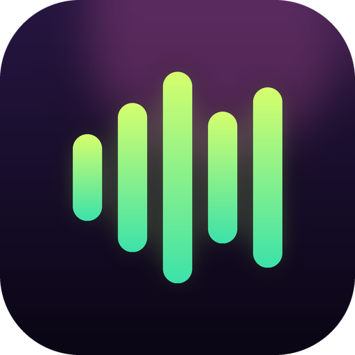

# Ritm

A simple music player for the songs on your phone. Pick your files once, then control the music from a notification or from a floating bubble while you use other apps.

## Features
- Plays the music files from your phone, with playlists
- **Share with friends:** send one song, some songs, some playlists or all playlists as a single `.ritm` file. When a friend opens it with Ritm, the playlists appear by themselves, with the names you gave them
- **Notification** with cover, title and Previous / Play-Pause / Next / Stop, also on the lock screen
- **Floating bubble** over other apps: song, playlist and position (for example 2/30), a bar to jump anywhere in the song, Previous / Play-Pause / Next, repeat this song and the app volume
- Play modes: Loop, Shuffle, Repeat 1, In order
- Sleep timer
- Keeps playing while you watch a video or use another app (a phone call still stops it)
- Comes back where you stopped, and the bubble or the notification can start the music again even after the app was closed by Android
- Keeps playing with the screen off (use the **Allow background playback** button in Settings; on some phones also set the battery to "No restrictions")

## Get the APK
This repository builds the app with GitHub Actions. Open the **Actions** tab, run **Build Android APK** (it also starts on every push) and download **ritm-debug-apk** from the **Artifacts** section. Unzip it and install `app-debug.apk`; Android will ask you to allow installing from this source.

Every build is signed with the same key (`signing/ritm.p12`) and has a rising version number, so a new APK installs **over** the old one and keeps your songs. (If you installed an older build that used a different key, remove it once.) This key is public, like Android's default debug key: it is meant for sharing the app with friends, not for publishing in a store.

## How it is built
The app itself is a web page (`www/index.html`) packaged with [Capacitor](https://capacitorjs.com/). The Android part (player service, notification, bubble) is in `native/java`. `scripts/apply-native.js` copies it, and the app icon, into the Android project that is generated on every build.

The page loads two fonts from Google Fonts; without internet it simply falls back to the system fonts. The music itself never leaves your phone.

## License
GPL-3.0-only. See [LICENSE](LICENSE).
